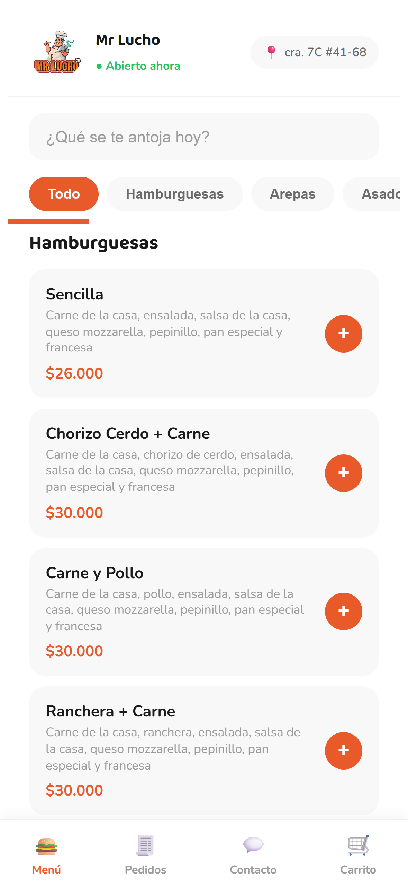
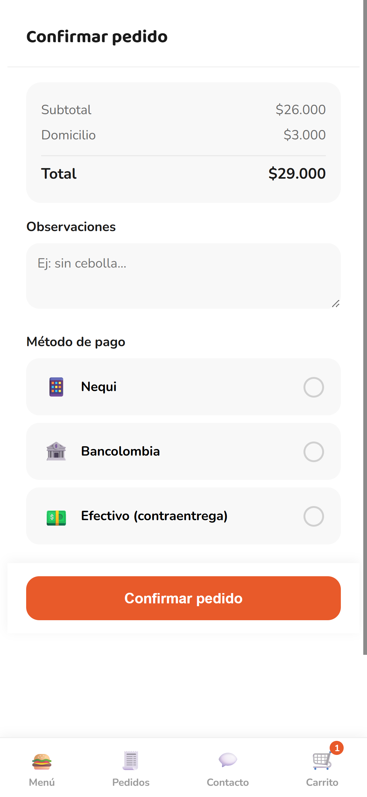
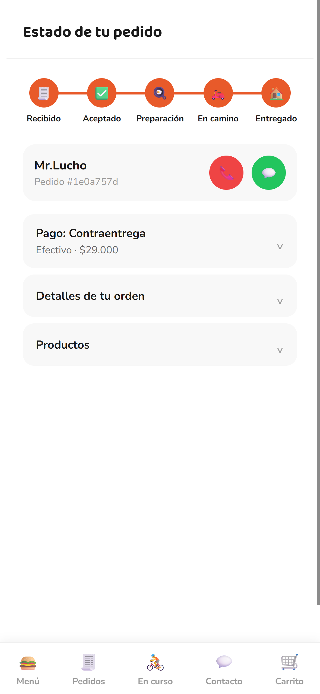
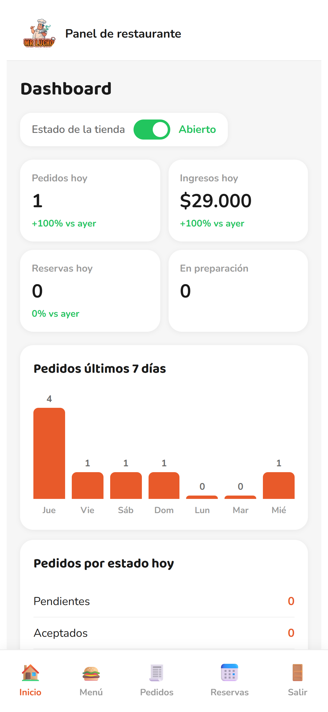
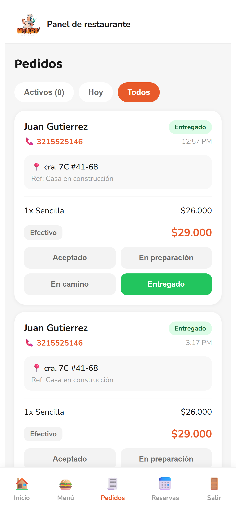

# Orderly

Plataforma web para automatizar los pedidos a domicilio de restaurantes de comida rápida. Primer cliente: **Mr Lucho** (comidas rápidas y asados).

Tiene dos interfaces:

- **Tienda del cliente** (sin login, pensada para celular): menú con buscador, carrito, checkout con pago y comprobante, y seguimiento del pedido.
- **Panel del restaurante** (con login): gestión de pedidos, menú, reservas y dashboard.

## Tecnologías

- **Frontend:** Angular 22 (componentes standalone), TypeScript, CSS propio
- **Backend:** Django 6.1, Django REST Framework, SimpleJWT
- **Base de datos:** PostgreSQL

## Funcionalidades

- Carrito con adiciones por producto y pedidos sin necesidad de crear cuenta
- Pago por Nequi, Bancolombia (con foto del comprobante) o efectivo
- El servidor recalcula precios y total, sin confiar en lo que envía el cliente
- Seguimiento del pedido con línea de estados, actualizada cada pocos segundos
- Panel con dashboard (comparativo contra ayer y gráfica de 7 días)
- Autenticación con JWT y rutas protegidas
- Pruebas automáticas de pedidos y permisos

## Capturas

### Tienda del cliente

<p>
  
  
  
</p>

### Panel del restaurante

<p>
  
  
</p>

## Cómo ejecutarlo en local

### Backend

```
cd backend
python -m venv venv
venv\Scripts\activate
pip install -r requirements.txt
```

Crea el archivo `backend/.env` copiando `backend/.env.example` y completa tus valores. Luego:

```
python manage.py migrate
python manage.py createsuperuser
python manage.py cargar_menu
python manage.py runserver
```

### Frontend

```
cd frontend
npm install
ng serve
```

### Direcciones

- Tienda del cliente: http://localhost:4200/tienda
- Panel del restaurante: http://localhost:4200/login
- Admin de Django: http://127.0.0.1:8000/admin/

## Pruebas

```
cd backend
python manage.py test
```

## Autor

Juan Esteban Gutiérrez Arango